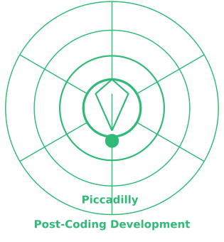
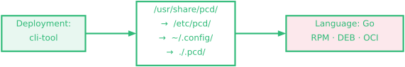
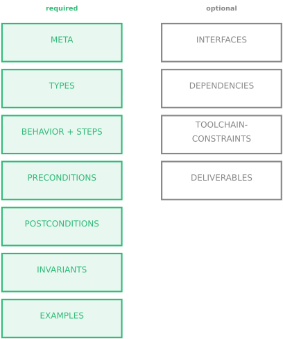
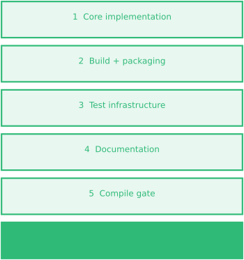
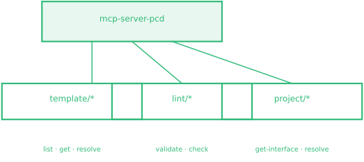
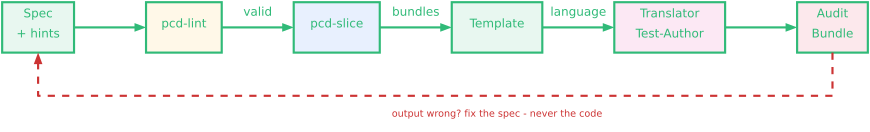

--- 
title: Post-Coding Development
subtitle: "Meet me at the PiCcaDilly - where intent becomes implementation"
author: Matthias G. Eckermann
date: 2026-03-25
theme: "Frankfurt"
colortheme: "spruce"
fonttheme: "professionalfonts"
fontsize: 10pt
urlcolor: blue
linkstyle: bold
aspectratio: 169
lang: en-US
slide-level: 2
toc: false
header-includes:
  - \addtobeamertemplate{footline}{}{\begin{par}\hspace*{1mm}\copyright{}~2026, Matthias G. Eckermann,~Potsdam, Germany\vspace*{1mm}\par\vspace*{-4.5mm}\end{par}\hspace*{\fill}\includegraphics[height=5mm]{pcd-icon-green.png}}
  - \setbeamercolor{structure}{fg=MSUgreen}
  - \setbeamercolor{section in head/foot}{fg=black}
  - \setbeamercolor{title in head/foot}{fg=black}
  - \setbeamercolor{section in toc}{fg=black}
  - \setbeamercolor{subsection in toc}{fg=black}

---

# What

## Human Intent, Machine Implementation

::::columns
:::: {.column width=60%}

Domain experts write **specifications**.

AI generates **all** implementation code.

Engineers never write implementation code directly.

\medskip

\textit{Not vibe coding:} if the output is wrong,\
you fix the **spec** --- never the code.

::::
:::: {.column width=40%}

{height=5cm}

::::
::::

---

## This is not "AI-assisted coding"

+---------------------+---------------+---------------+-------------------+
|                     | Traditional   | Vibe Coding   | **PCD**          |
+=====================+===============+===============+===================+
| Human writes        | code          | code + prompts| **specs only**    |
+---------------------+---------------+---------------+-------------------+
| AI role             | none          | suggests      | **translates**    |
+---------------------+---------------+---------------+-------------------+
| Primary artifact    | source code   | source code   | **specification** |
+---------------------+---------------+---------------+-------------------+
| Target language     | developer     | developer     | **template**      |
+---------------------+---------------+---------------+-------------------+
| Regulated domains   | manual audit  | prohibited    | **enabled**       |
+---------------------+---------------+---------------+-------------------+

\bigskip

In vibe coding, if the output is wrong, you edit the code.\
In PCD, **you never touch the code** --- you fix the spec and regenerate.

---

## The specification

::::columns
:::: {.column width=50%}

```markdown
## BEHAVIOR: transfer
INPUTS:
  from: Account
  amount: Amount
STEPS:
  1. Validate preconditions.
  2. Debit from.balance.
  3. Credit to.balance.
POSTCONDITIONS:
  - SUM(balances) unchanged
EXAMPLES:
  EXAMPLE: success
  GIVEN: balance = 100
  WHEN:  transfer(30)
  THEN:  balance = 70
```

::::
:::: {.column width=50%}

No programming language.

No target platform.

No toolchain knowledge required.

The **template** decides all of that.

::::
::::

# Why

## 1. Separation of concerns

::::columns
:::: {.column width=50%}

The spec says **what** and **where**.

The template decides **how**:

- programming language
- packaging format
- toolchain conventions
- deployment target

::::
:::: {.column width=50%}

Change language across the whole project?

**Change one preset file.**

The spec is untouched.

A spec written today is valid\ 
in 2045 --- regardless of\ 
what language is in fashion.

::::
::::

---

## 2. Long-term maintainability

::::columns
:::: {.column width=55%}

**Specs are more stable than code.**

Code accumulates technical debt.

Specs describe intent --- intent rarely changes.

\bigskip

When requirements change:

- update the spec
- regenerate the code
- no manual refactoring

::::
:::: {.column width=45%}

**The spec is the documentation.**

Not a comment that drifts from the code.

Not a wiki page nobody updates.

The running system is always\ 
derived from the spec.

::::
::::

---

## 3. Domain experts author directly

::::columns
:::: {.column width=50%}

**Today**


Every handoff loses information.\
Requirements get simplified.\
Misunderstandings go undetected.

::::
:::: {.column width=50%}

**With PCD**


The cardiologist specifies\
the device behaviour directly.

No interpreter in the middle.

::::
::::

---

## And: formal verification is available

The LLM translation is probabilistic --- we do not claim otherwise.

\bigskip

For components that **require** stronger guarantees:

\bigskip

::::columns
:::: {.column width=60%}

Lean 4, F*, or Dafny can be added\ 
as an **optional verification layer** ---\ 
without changing the specification format.

The spec stays the same.\ 
The verification path is a template choice.

::::
:::: {.column width=40%}

- memory safety by construction
- formal proofs of invariants
- state machine correctness
- ISO 26262 / DO-178C evidence

::::
::::

---

## Proof: pcd-lint

`pcd-lint` --- the specification validator --- was\ 
**specified and generated using PCD itself.**

Zero hand-written implementation code.

\bigskip

Tested across multiple AI models,\ 
three continents, one result:

\bigskip

\begin{center}
\Large Every model resolved Go from the template\\
\large without being told.
\end{center}

---

# How

## The workflow

{height=3cm}

1. Domain expert writes a spec (or AI interviews them)
2. `pcd-lint` validates structure
3. Deployment template resolves the language
4. LLM translates spec \textrightarrow{} code + audit bundle

---

## Language is never your problem

{height=3cm}

The spec declares **what** and **where** (deployment context).

The template resolves **language, packaging, conventions**.

A spec written today is valid if the organisation\
switches from Go to Rust in 2045 --- **no spec change needed**.

---

## The audit bundle

::::columns
:::: {.column width=50%}

Every translation produces:

- specification (human-reviewable)
- generated source code
- packaging artifacts (RPM, DEB, OCI)
- independent test suite
- translation report
- workflow diagram (Pikchr)
- metadata + hashes

::::
:::: {.column width=50%}

Designed for:

- ISO 26262 (automotive)
- DO-178C (aviation)
- IEC 62304 (medical)
- Common Criteria EAL4+
- EU Cyber Resilience Act

::::
::::

---

## Getting started

::::columns
:::: {.column width=50%}

**Write a spec (no format knowledge needed):**

```bash
# AI interviews the domain expert:
ollama run llama3.2 \
  "$(cat prompts/interview-prompt.md)"
```

Then validate:

```bash
pcd-lint myspec.md
```

::::
:::: {.column width=50%}

**Translate to code:**

```bash
# mcphost with the translator prompt
# reads template + spec,
# produces code + audit bundle
```

\bigskip

Everything in the repo:\
**github.com/mge1512/pcd**

::::
::::
# The specification

## Spec sections

::::columns
:::: {.column width=45%}

{height=6cm}

::::
:::: {.column width=55%}

`pcd-lint` validates structure\
before any translation begins.

\bigskip

**Key constraints:**

- BEHAVIOR must include `STEPS:`
- INVARIANTS carry `[observable]`\
  or `[implementation]` tags
- EXAMPLES must cover error paths
- No programming language in spec

::::
::::

---

## BEHAVIOR in depth

::::columns
:::: {.column width=52%}

```markdown
## BEHAVIOR: shutdown
Constraint: required
INPUTS:
  vm: VirtualMachine
PRECONDITIONS:
  - vm.state = Running
STEPS:
  1. Send shutdown signal.
  2. Record shutdown-start time.
     MECHANISM: do NOT block;
     requeue immediately.
  3. On re-entry: check elapsed.
     If > timeout: Destroy(vm).
POSTCONDITIONS:
  - vm.state = Stopped
```

::::
:::: {.column width=48%}

`STEPS` = the algorithm,\
not just the contract.

\bigskip

`MECHANISM:` = where the\
*how* matters for correctness.

\bigskip

`Constraint:` field:

- `required` --- always implement
- `supported` --- preset activates it
- `forbidden` --- never implement

::::
::::

---

## INTERFACES: testable abstractions

```markdown
## INTERFACES

Transport {
  required-methods:
    Connect(ctx, spec) -> (Session, error)
  implementations-required:
    production:  RealTransport
    test-double: FakeTransport {
      configurable: ConnectErr, Sessions
    }
}
```

\bigskip

Independent tests use **only** declared test doubles.\
`go test ./independent_tests/` runs without any live service.

---

# Templates and translation

## Deployment templates

::::columns
:::: {.column width=50%}

Templates encode **everything** the spec does not:

- target language + alternatives
- binary type, packaging formats
- CLI conventions
- security constraints
- TYPE-BINDINGS
- delivery phases (EXECUTION)
- compile gate

::::
:::: {.column width=50%}

{height=3cm}

\bigskip

One preset file changes\
language for the whole project.

The spec is untouched.

::::
::::

---

## TYPE-BINDINGS: no translator discretion

Template excerpt:

```markdown
## TYPE-BINDINGS
| Spec type  | LANGUAGE=Go           |
|------------|-----------------------|
| Duration   | metav1.Duration       |
| Timestamp  | metav1.Time           |
| Condition  | metav1.Condition      |
| List<T>    | []T                   |
```

\bigskip

Without TYPE-BINDINGS: one translator produces `string`,\
another produces `metav1.Duration` --- incompatible at the API level.

\bigskip

With TYPE-BINDINGS: **deterministic, language-specific types** --- applied\
mechanically, not by translator judgement.

---

## The translation phases

::::columns
:::: {.column width=40%}

{height=5.5cm}

::::
:::: {.column width=60%}

Defined in the template's\
`## EXECUTION` section ---\
**not** in the prompt.

\bigskip

**Resume logic:** partial runs\
restart from the first missing file.

\bigskip

**Compile gate** is language-specific:

```bash
go mod tidy   # direct deps only
              # no fabricated versions
go build ./...
```

\bigskip

`TRANSLATION_REPORT.md` is\
**always last** --- its presence\
signals a complete run.

::::
::::

---

# Tooling

## pcd-lint

::::columns
:::: {.column width=55%}

**What it validates:**

- required sections present
- META fields + SPDX license
- deployment template resolves
- BEHAVIOR has STEPS
- INVARIANTS have tags
- EXAMPLES cover error paths
- Constraint: field values
- cross-section consistency

::::
:::: {.column width=45%}

**Self-hosting:**

`pcd-lint` was specified and\
generated using PCD itself.

\bigskip

Running `pcd-lint` against\
its own spec passes --- the\
paradigm validates itself.

\bigskip

```bash
pcd-lint myspec.md
pcd-lint strict=true myspec.md
pcd-lint list-templates
```

::::
::::

---

## Translation confidence

Every `TRANSLATION_REPORT.md` includes:

\bigskip

+----------------+------------+-------------------------------------+--------------------+
| EXAMPLE        | Confidence | Verification method                 | Unverified claims  |
+================+============+=====================================+====================+
| vm-start       | High       | `TestVMStart` --- FakeSession         | libvirt UUID format|
+----------------+------------+-------------------------------------+--------------------+
| graceful-stop  | Medium     | `TestGracefulStop` pass 1 only      | timeout path       |
+----------------+------------+-------------------------------------+--------------------+
| host-ready     | Low        | none                                | entire sequence    |
+----------------+------------+-------------------------------------+--------------------+

\bigskip

- **High** = named test in `independent_tests/` passes without live services
- **Medium** = partial test coverage
- **Low** = reasoning only --- no test

\bigskip

Unverified claims must be listed **explicitly**. Never silently omitted.

---

## Large projects

::::columns
:::: {.column width=55%}

**Architect defines interfaces first:**

```markdown
## INTERFACE
EXPORTS:
  TYPES:  Account, TransferResult
  BEHAVIOR: transfer
  INVARIANTS:
    - GLOBAL: balance >= 0
```

\bigskip

Component specs declare imports:

```markdown
Imports:
  - account-svc: ./account.md
                 #INTERFACE@>=1.2.0
```

::::
:::: {.column width=45%}

**Rules:**

- interfaces before implementation
- build order = topological sort
- no circular dependencies
- component fits in one LLM\
  context window

\bigskip

**pcd-lint v2** (planned):\
validates full project graph ---\
imports, circular deps,\
interface versioning.

::::
::::

---

## mcp-server-pcd

::::columns
:::: {.column width=45%}

{height=4cm}

::::
:::: {.column width=55%}

Any MCP-capable host connects directly:

- **mcphost** (CLI)
- **VS Code** with Copilot
- **Claude Desktop**
- custom agents

\bigskip

Preset layering server-side:\
vendor \textrightarrow{} `/etc/pcd-server/` \textrightarrow{} team \textrightarrow{} user

\bigskip

The LLM is the wizard.\
The server is the data layer.

::::
::::
<!--
  Update chunk, 2026-09. Standalone slides covering what changed since
  the 2026-04 introduction. Build options:
    - cat after pcd-intro-50-technical.md in the Makefile pipeline, or
    - build alone behind pcd-intro-00-header.md.
  Requires pcd-workflow-full.png (from pcd-workflow-full.pikchr).
-->

# Update: April to September 2026

## Whitepaper 0.3.22 to 0.4.6: what changed

| Area | Change |
|---|---|
| Composition | `Includes:` merges shared specs into a host spec; merged spec hash; RULE-19 to RULE-21 |
| TYPES | Tabular TYPE grammar, closed cell vocabularies; RULE-22 to RULE-25; JSON Schema emission |
| Provenance | Reports record a SHA-256 for every translation input, not the spec hash alone |
| Verification | Tests-first enforced structurally; roles renamed to translator / test-author |
| Templates | 14 deployment templates, was 9: abap-report, cockpit-module, kubectl-style-cli, library, spack-package added |
| Tooling | `pcd-slice` shipped; `libpcd` and `pcd-emit-types` specified |

\bigskip

The reproducibility unit is now a tuple: spec + resolved language + hints and template set.\
The spec hash attests intended behaviour; it does not alone determine the binary.

---

## pcd-lint: from 17 to 25 rules - and one engine

**Rules added since April:**

- RULE-18: generated output embeds the correct spec hash (`check-report=true`)
- RULE-19 to RULE-21: composition - paths resolve, no name collisions, inclusion graph acyclic
- RULE-22 to RULE-25: tabular TYPES - structure, cell vocabulary, references, lifecycle

\bigskip

**Consolidation into one engine:**

- Every rule is written once, in `tools/shared/spec/`, and composed via `Includes:` into `libpcd`
- `pcd-lint`, `pcd-emit-types` (TYPE tables to JSON Schema), and `mcp-server-pcd` are thin front ends binding to that engine
- Lint parity between CLI and MCP holds by construction, not by copy discipline

\bigskip

Status: `pcd-lint` shipped - Go, RPM and DEB from the Open Build Service.\
`libpcd` and `pcd-emit-types`: specified, translation pending.

---

## pcd-slice: bundles instead of full-spec reads

A translation reads the spec many times - per milestone, per role.\
One full pass over a 41-BEHAVIOR production spec is on the order of 70K tokens.

\bigskip

`pcd-slice` derives the semantic form once, deterministically:

- One preamble with what every bundle shares: version, intro, full TYPES, global invariants.\
  Byte-identical across bundles, so it becomes a cacheable prompt prefix.
- One bundle per BEHAVIOR: the block verbatim, its examples, its invariants, its hints, its type closure by name

\bigskip

- Every emitted file records the SHA-256 of its sources; `pcd-slice check` detects stale bundles
- The source spec is never modified: bundles are build output, regeneratable
- `skills/pcd-translate` guards a session: translation reads bundles, never the spec

\bigskip

Shipped: Go, single static binary, standard library only, packaged via OBS.\
Read-cost reduction on production specs: typically 50 to 65 percent, before caching.

---

## The workflow, updated

{width=100%}

1. Domain expert writes the spec, or an AI interview produces it
2. `pcd-lint` validates: 25 rules, before any translation
3. `pcd-slice` derives the preamble and the per-BEHAVIOR bundles
4. The deployment template resolves language, packaging, conventions
5. Translator and test-author produce code, tests, and the audit bundle

If the output is wrong: fix the spec and regenerate. The code is never touched.
